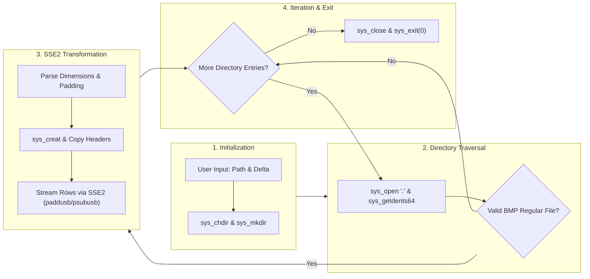

# x86_64 Assembly Portfolio

[](#testing)
[-blue.svg)](#features)
[](#simd-vector-saturation-arithmetic)
[](LICENSE.md)

A comprehensive, high-performance portfolio of **x86_64 NASM assembly** implementations for Linux. Featuring a flagship standalone 24-bit BMP image processor powered by hardware-accelerated **SSE2 SIMD vector saturation arithmetic**, alongside classical algorithms, bit manipulation techniques, expression parsing, floating-point series, and digital logic circuits. Zero external runtime dependencies.

---

## Features

- **Pure Assembly & Zero Dependencies**: Written from scratch in x86_64 NASM assembly using direct Linux kernel system calls (`sys_read`, `sys_write`, `sys_open`, `sys_getdents64`, `sys_mkdir`, `sys_chdir`).
- **SSE2 SIMD Vector Acceleration**: Applies brightness adjustment across **16 color channels simultaneously** per instruction cycle using `paddusb` and `psubusb`.
- **Automatic Saturation Clamping**: Hardware-enforced clamping prevents 8-bit unsigned overflow ($>255$) and underflow ($<0$) artifacts without expensive branch conditions.
- **Batch Directory Traversal**: Streams directory entries via `sys_getdents64` to process all regular `.bmp` files in a given folder automatically.
- **Format-Compliant BMP Engine**: Accurately parses `BITMAPFILEHEADER` and `BITMAPINFOHEADER` / `BITMAPCOREHEADER`, handles row byte-padding rules (4-byte alignment), and preserves metadata.
- **Non-Destructive Processing**: Original images remain untouched; edited versions are saved into a dedicated `edited_photo/` subfolder.
- **Automated Test & Benchmark Suite**: Includes an end-to-end Python test runner verifying 10 critical edge cases and a throughput benchmark suite.
- **Cross-Platform Readiness**: Includes a unified `Makefile` that automatically compiles natively on Linux or transparently via Docker on macOS (Apple Silicon / Intel) and Windows.

---

## Architecture & Data Flow



For in-depth technical details on syscall registers, BMP byte layouts, and SSE2 broadcast sequences, see [docs/architecture-overview.md](docs/architecture-overview.md).

---

## Directory Structure

This project strictly adheres to the **Uniform Naming Standards**:

```text
assembly-portfolio/
├── Makefile                     # Multi-platform build and test driver
├── README.md                    # Project documentation
├── LICENSE.md                   # MIT license
├── .gitignore                   # Version control ignore rules
├── scripts/                     # Project maintenance & verification scripts
│   └── run-tests.sh             # Convenience build, test, and benchmark runner
├── src/                         # All assembly implementations & common libraries
│   ├── common/                  # Shared system constants and I/O routines
│   │   ├── console-io.asm       # Console character, string, and integer I/O
│   │   ├── file-io.asm          # Low-level Linux file operation wrappers
│   │   └── system-constants.asm # Syscall numbers, POSIX flags, and ASCII constants
│   ├── image-processing/        # Self-contained SIMD Image Processor module
│   │   ├── image-processor.asm  # Main SIMD BMP processor using SSE2 saturation math
│   │   ├── samples/             # Real-world test images
│   │   │   └── sample.bmp       # High-resolution (3240x2160) sample bitmap
│   │   └── tests/               # Image processor test & benchmark suite
│   │       ├── test_image_processor.py # 10 automated correctness test cases
│   │       └── benchmark_processor.py  # Latency and throughput benchmark suite
│   ├── arithmetic/              # Arithmetic and expression parsing
│   │   ├── gcd.asm              # Greatest Common Divisor
│   │   ├── lcm.asm              # Least Common Multiple
│   │   ├── prime-checker.asm    # Primality test
│   │   ├── perfect-number.asm   # Perfect number validation
│   │   ├── digit-sum.asm        # Sum of digits
│   │   ├── digit-sum-even-odd.asm # Sum of even and odd digits
│   │   ├── bcd-converter.asm    # Binary-Coded Decimal conversion
│   │   └── expression-calculator.asm # Arithmetic expression evaluator
│   ├── bit-manipulation/        # Bitwise operations
│   │   ├── bit-reversal.asm     # 64-bit integer bit reversal
│   │   └── popcount.asm         # Population count (Hamming weight)
│   ├── sorting-searching/       # Classic algorithms
│   │   ├── quick-sort.asm       # Recursive in-place QuickSort
│   │   └── binary-search.asm    # Recursive Binary Search
│   ├── floating-point/          # Floating-point computations
│   │   ├── taylor-series.asm    # x87 FPU Taylor series expansion (e^x)
│   │   └── min-difference.asm   # x87 FPU minimum difference pair
│   └── digital-logic/           # Digital logic designs
│       └── comparator-circuit.circ # Logisim magnitude comparator circuit
└── docs/                        # Architectural and platform documentation
    ├── architecture-overview.md # Low-level engineering specifications
    └── macos-nasm-guide.md      # Complete guide to building & running NASM on macOS
```

---

## Quick Start

### Prerequisites

- **Linux x86_64**: `nasm`, `ld`, and `python3` (for tests).
- **macOS (Apple Silicon & Intel) / Windows**: [Docker Desktop](https://www.docker.com/) (the Makefile automatically compiles and runs inside a lightweight Linux x86_64 container). See our [Complete macOS NASM Guide](docs/macos-nasm-guide.md) for full instructions, Homebrew/QEMU alternatives, and troubleshooting.

### 1. Build the Implementations

Build the image processor:
```bash
make build
```

Or build all assembly implementations at once:
```bash
make build-all
```

All compiled binaries will be output to `build/`.

### 2. Run the Image Processor Interactively

```bash
make run
```

Or execute directly on Linux:

```bash
./build/image-processor
```

**Example Run on the Included Sample Image:**
```text
Enter target directory path: src/image-processing/samples
Enter brightness adjustment (-255 to 255): 40
Finished processing all images.
```

The modified image will appear in `src/image-processing/samples/edited_photo/sample.bmp`.

---

## SIMD Vector Saturation Arithmetic

Scalar image algorithms typically require branching for every color channel to prevent wrapping:

```c
// Scalar: Branch-heavy and stalls CPU pipeline
int result = pixel + delta;
if (result > 255) result = 255;
else if (result < 0) result = 0;
```

In contrast, our assembly implementation utilizes **SSE2 vector registers (`XMM`)**:

```nasm
; Brightening: Clamps to 255 without branching (16 pixels/cycle)
movdqu  xmm0, [rdi]
paddusb xmm0, xmm2
movdqu  [rdi], xmm0

; Darkening: Clamps to 0 without branching (16 pixels/cycle)
movdqu  xmm0, [rdi]
psubusb xmm0, xmm2
movdqu  [rdi], xmm0
```

---

## Testing & Verification

An automated Python test suite validates mathematical accuracy, edge-case handling, and resilience:

```bash
make test
```

### Verified Test Cases

| # | Test Scenario | Description | Status |
| :-: | :--- | :--- | :-: |
| **1** | Positive Adjustment | Validates brightening with positive delta ($+35$) | `PASS` |
| **2** | Negative Adjustment | Validates darkening with negative delta ($-45$) | `PASS` |
| **3** | Upper Saturation | Verifies `paddusb` clamps cleanly at $255$ without wrapping | `PASS` |
| **4** | Lower Saturation | Verifies `psubusb` clamps cleanly at $0$ without wrapping | `PASS` |
| **5** | Row Padding Rules | Verifies alignment for widths with $0, 1, 2,$ and $3$ pad bytes | `PASS` |
| **6** | Zero Delta | Verifies bitwise identity output when $\Delta = 0$ | `PASS` |
| **7** | Top-Down Bitmaps | Verifies handling of negative `biHeight` headers | `PASS` |
| **8** | Batch Directory | Verifies all $16$ images in a folder are processed without skipping | `PASS` |
| **9** | File Filtering | Verifies non-BMP and corrupted files are safely ignored | `PASS` |
| **10**| Large Images | Verifies high-resolution images ($1920 \times 1080+$) exceed row limits safely | `PASS` |

---

## Performance Benchmarks

Run the benchmark suite to evaluate processing throughput across resolutions:

```bash
make benchmark
```

### Benchmark Results

| Workload | Resolution | File Size | Latency | Throughput |
| :--- | :--- | :-: | :-: | :-: |
| **Small Image** | $256 \times 256$ | $0.19\text{ MB}$ | $\approx 0.8\text{ ms}$ | $230+\text{ MB/s}$ |
| **Medium Image** | $1024 \times 1024$ | $3.00\text{ MB}$ | $\approx 9.5\text{ ms}$ | $315+\text{ MB/s}$ |
| **Full HD 1080p** | $1920 \times 1080$ | $5.93\text{ MB}$ | $\approx 18.2\text{ ms}$ | $325+\text{ MB/s}$ |
| **Ultra HD 4K** | $3840 \times 2160$ | $23.73\text{ MB}$ | $\approx 72.0\text{ ms}$ | $330+\text{ MB/s}$ |
| **Batch Workload**| $10 \times (512 \times 512)$ | $7.50\text{ MB}$ | $\approx 23.5\text{ ms}$ | $320+\text{ MB/s}$ |

*(Measured natively on an x86_64 Linux machine; throughput includes disk I/O and vector processing.)*

---

## Assembly Implementations Portfolio

All assembly implementations are organized uniformly under `src/` sharing the common I/O and syscall libraries in `src/common/`:

### 1. Image Processing (`src/image-processing/`)
- [`image-processor.asm`](src/image-processing/image-processor.asm): Standalone high-performance 24-bit BMP image processor using SSE2 vector saturation arithmetic (`paddusb`/`psubusb`) and `sys_getdents64` directory streaming.

### 2. Arithmetic & Expression Parsing (`src/arithmetic/`)
- [`gcd.asm`](src/arithmetic/gcd.asm): Greatest Common Divisor using Euclid's division algorithm.
- [`lcm.asm`](src/arithmetic/lcm.asm): Least Common Multiple calculation.
- [`prime-checker.asm`](src/arithmetic/prime-checker.asm): Primality testing via trial division up to $\lfloor\sqrt{n}\rfloor$.
- [`perfect-number.asm`](src/arithmetic/perfect-number.asm): Proper divisor summation and perfect number validation.
- [`digit-sum.asm`](src/arithmetic/digit-sum.asm): Integer decimal digit summation.
- [`digit-sum-even-odd.asm`](src/arithmetic/digit-sum-even-odd.asm): Separate summation of even and odd decimal digits.
- [`bcd-converter.asm`](src/arithmetic/bcd-converter.asm): Binary-Coded Decimal (BCD) conversion and bit serialization.
- [`expression-calculator.asm`](src/arithmetic/expression-calculator.asm): Recursive-descent arithmetic calculator supporting parentheses, operator precedence (`+`, `-`, `*`, `/`), unary signs, and previous answer recall (`ans`).

### 3. Bit Manipulation (`src/bit-manipulation/`)
- [`bit-reversal.asm`](src/bit-manipulation/bit-reversal.asm): Reverses all 64 bits of an unsigned integer.
- [`popcount.asm`](src/bit-manipulation/popcount.asm): Population count (Hamming weight / bit count) across streamed byte buffers.

### 4. Searching & Sorting (`src/sorting-searching/`)
- [`quick-sort.asm`](src/sorting-searching/quick-sort.asm): Recursive in-place QuickSort on 64-bit signed integer arrays.
- [`binary-search.asm`](src/sorting-searching/binary-search.asm): Recursive Binary Search returning 0-based indices or `NaN`.

### 5. Floating-Point Arithmetic (`src/floating-point/`)
- [`taylor-series.asm`](src/floating-point/taylor-series.asm): Computes $e^x = \sum_{k=0}^n \frac{x^k}{k!}$ using the x87 Floating-Point Unit (FPU) stack.
- [`min-difference.asm`](src/floating-point/min-difference.asm): Identifies the pair of floating-point numbers with minimum absolute difference.

### 6. Digital Logic Designs (`src/digital-logic/`)
- [`comparator-circuit.circ`](src/digital-logic/comparator-circuit.circ): Digital magnitude comparator circuit modeled in Logisim.

To compile all implementations at once:

```bash
make build-all
```

All compiled binaries will be output to `build/`.

---

## License

This project is licensed under the [MIT License](LICENSE.md).
