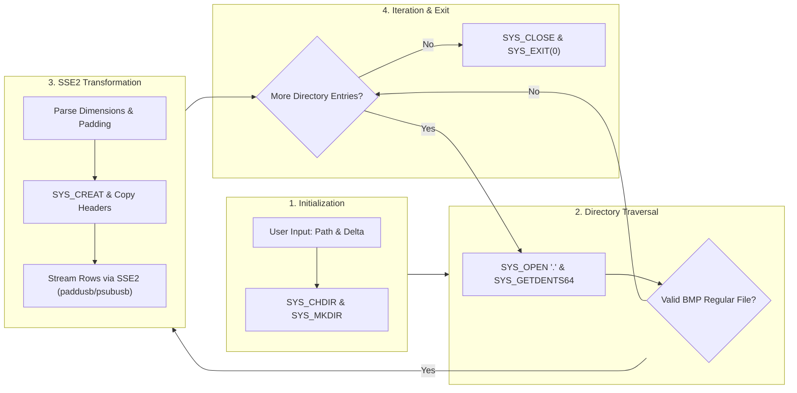
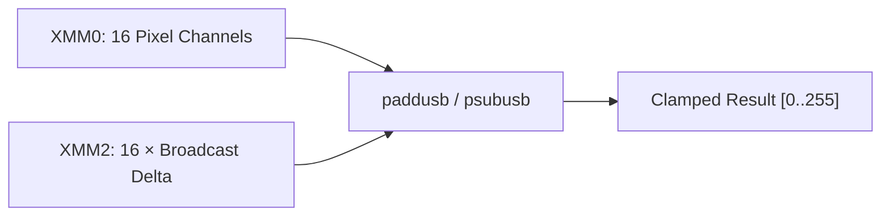

# Architecture & Technical Deep-Dive

This document details the architectural principles, low-level system call interfaces, image format specifications, and SIMD vector math utilized by the **Assembly Image Processor**.

---

## 1. System Architecture

The image processor is implemented purely in 64-bit x86-64 assembly using the NASM assembler for the Linux ELF64 target. It relies strictly on Linux kernel system calls without linking against libc or any external runtime libraries.



---

## 2. Linux x86_64 System Call Conventions

Linux system calls use the `syscall` CPU instruction. Register conventions for system calls differ from the System V AMD64 ABI user-space function calling convention:

| Role | Register | Notes |
| :--- | :--- | :--- |
| **Syscall Number** | `RAX` | e.g., 0 for read, 1 for write, 217 for getdents64 |
| **Arg 1** | `RDI` | First argument (file descriptor, path pointer, etc.) |
| **Arg 2** | `RSI` | Second argument (buffer pointer, flags, etc.) |
| **Arg 3** | `RDX` | Third argument (byte count, mode, etc.) |
| **Arg 4** | `R10` | *Note: differs from userspace ABI which uses `RCX`* |
| **Arg 5** | `R8` | Fifth argument |
| **Arg 6** | `R9` | Sixth argument |
| **Return Code** | `RAX` | Non-negative on success, `-errno` on failure |
| **Clobbered** | `RCX`, `R11` | Overwritten by CPU during `syscall` instruction |

---

## 3. Directory Traversal (`sys_getdents64`)

Rather than relying on `readdir(3)` from libc, the program directly invokes `sys_getdents64` (syscall `217`).

### `linux_dirent64` Memory Layout

Each directory entry in the returned buffer is laid out sequentially:

```
+------------------------------------------------------------+
| Offset  0 (8B):  d_ino    (64-bit Inode number)             |
| Offset  8 (8B):  d_off    (64-bit Directory stream offset)  |
| Offset 16 (2B):  d_reclen (Record length in bytes)          |
| Offset 18 (1B):  d_type   (File type indicator: 8 = DT_REG) |
| Offset 19 (var): d_name[] (Null-terminated ASCII filename)  |
+------------------------------------------------------------+
```

### Traversal Algorithm

1. Invoke `sys_getdents64(dir_fd, buffer, capacity)`.
2. Set pointer `R12 = buffer`, `R13 = buffer + bytes_read`.
3. Read `d_reclen = [R12 + 16]` and `d_type = [R12 + 18]`.
4. If `d_type == 8` (regular file), pass `R12 + 19` (`d_name`) to `process_single_image`.
5. Advance `R12 += d_reclen`.
6. Repeat until `R12 >= R13`, then issue another `sys_getdents64` until 0 entries remain.

---

## 4. BMP File Format & Dimension Parsing

The processor targets 24-bit uncompressed bitmaps (`BI_RGB`).

### Header Layout

1. **`BITMAPFILEHEADER` (14 bytes)**:
   - `0..1` (2 bytes): Magic signature `0x4D42` (`'BM'`).
   - `2..5` (4 bytes): Total file size.
   - `6..9` (4 bytes): Reserved (0).
   - `10..13` (4 bytes): `bfOffBits` — offset to the pixel array (typically 54 bytes).

2. **DIB Header (`BITMAPINFOHEADER` / `BITMAPCOREHEADER`)**:
   - `14..17` (4 bytes): `biSize` — header size (12 bytes for Core Header, 40+ for Info Header).
   - If `biSize == 12`: Width and height are 16-bit words.
   - If `biSize >= 40`: Width and height are 32-bit dwords.

### Row Padding Calculation

In the BMP specification, every row must be padded to a multiple of 4 bytes:

$$\text{row\\_bytes} = \text{width} \times 3$$

$$\text{padding\\_bytes} = (4 - (\text{row\\_bytes} \pmod 4)) \pmod 4$$

$$\text{stride} = \text{row\\_bytes} + \text{padding\\_bytes}$$

The padding bytes must not be modified by the brightness algorithm; they are streamed directly from the input image to the output image.

---

## 5. SIMD Vector Saturation Arithmetic

Scalar image processing requires checking for overflow ($> 255$) and underflow ($< 0$) on every single color channel, requiring branch instructions that stall CPU pipelines.

The assembly processor leverages **SSE2 packed unsigned byte saturation arithmetic**:



### Instructions

- **Brightening (`paddusb xmm0, xmm2`)**:
  Computes byte-wise unsigned addition with saturation. Any result exceeding $255$ is clamped at $255$ rather than wrapping around to $0$.

- **Darkening (`psubusb xmm0, xmm2`)**:
  Computes byte-wise unsigned subtraction with saturation. Any result dropping below $0$ is clamped at $0$ rather than wrapping around to $255$.

### Broadcast Setup

To replicate an 8-bit scalar delta across all 16 byte lanes of `XMM2` without requiring AVX2, the processor uses pure SSE2 instructions:

```nasm
movzx   eax, byte [brightness_delta]
movd    xmm2, eax               ; xmm2[31:0]   = 0x000000XX
punpcklbw xmm2, xmm2            ; xmm2[15:0]   = 0xXXXX
pshuflw xmm2, xmm2, 0           ; xmm2[63:0]   = 0xXXXXXXXXXXXXXXXX
pshufd  xmm2, xmm2, 0           ; xmm2[127:0]  = 16 copies of delta
```

This sequence executes in negligible CPU cycles during initialization and guarantees compatibility across 100% of x86-64 hardware.
